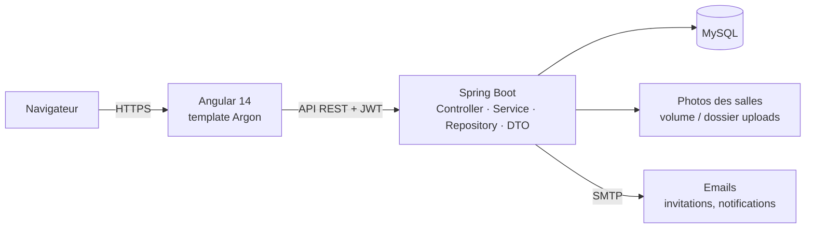

# Room & Event Booking (RBM)

Application web de **location et de gestion de salles** (séminaires, formations, mariages, événements d'entreprise). Les clients consultent les salles, vérifient leur disponibilité sur un créneau, voient le prix et demandent une réservation. L'administrateur gère les salles, les équipements et les utilisateurs, et valide les demandes.

Le cœur fonctionnel est la **détection des conflits de réservation** : une salle ne peut pas être réservée deux fois sur des créneaux qui se chevauchent.

> Projet de la formation **FullStack Spring Boot & Angular** (durée : 1 semaine).
> Étudiante : Majda · Enseignante : Dr. Hanen Harbaoui

## Accès à la démonstration

| | |
|---|---|
| Application | https://rbm-booking-platform.vercel.app/#|
| API | `https://rbm-booking-platform.onrender.com` |

> L'hébergement gratuit met l'API en veille après quelques minutes d'inactivité : **la première requête peut prendre environ une minute**. Les photos de salles téléversées sur cet hébergement ne sont pas conservées après un redémarrage du serveur.

## Fonctionnalités

**Client**
- Consulter les salles (photo, tarif, capacité, équipements, localisation) avec filtres.
- Rechercher les salles libres sur un créneau (par pas de 30 minutes, durée minimale 1 heure).
- Réserver, avec le **prix total affiché avant l'envoi** (le serveur reste la seule source de vérité).
- Consulter et annuler **ses** réservations (avant leur début), inviter des participants par email.
- Calendrier : ses réservations en détail, les autres créneaux confirmés en « Occupé » (sans titre ni nom).
- Modifier son profil et son mot de passe.

**Administrateur**
- CRUD des salles (tarif, photo, activation), des équipements et des utilisateurs.
- Voir toutes les réservations, **confirmer**, **refuser** ou **annuler**.
- Calendrier global avec tous les détails, tableau de bord (compteurs, chiffre d'affaires).

### Rôles et droits

| Ressource | Admin | Client |
|---|---|---|
| Utilisateurs (CRUD) | Oui | Non |
| Salles (CRUD, tarif, photo) | Oui | Lecture |
| Équipements (CRUD) | Oui | Lecture |
| Réservations : création | Oui | Oui |
| Réservations : lecture | Toutes | Les siennes |
| Réservations : confirmation / refus | Oui | Non |
| Réservations : annulation | Toutes | Les siennes, avant le début |
| Calendrier | Tous les détails | Créneaux occupés sans détails |
| Tableau de bord | Oui | Non |

### Règles de gestion (couvertes par des tests unitaires)

1. `dateFin` strictement postérieure à `dateDebut`, et `dateDebut` pas dans le passé.
2. Pas de chevauchement entre deux réservations **confirmées** d'une même salle : deux créneaux se chevauchent si `nouveauDebut < existantFin` **et** `nouveauFin > existantDebut` (un créneau qui commence exactement quand un autre se termine n'est pas un conflit).
3. `nbParticipants` ne dépasse pas la capacité de la salle.
4. Une salle désactivée ne peut pas être réservée.
5. Workflow des statuts : `EN_ATTENTE` → `CONFIRMEE` ou `REFUSEE` ; annulation possible (`ANNULEE`) ; **la confirmation revérifie l'absence de conflit**.
6. Une salle ayant des réservations futures confirmées ne peut pas être supprimée (seulement désactivée).
7. Prix : `prixTotal = durée en heures × tarifHoraire`, calculé côté serveur et figé dans la réservation.

## Architecture



| Couche | Technologies |
|---|---|
| Backend | Java 17, Spring Boot 4.1 (Web, Data JPA, Security, Validation, Mail), JWT (jjwt), BCrypt, Lombok |
| Frontend | Angular 14, template Argon Dashboard, FullCalendar 5 (guards, interceptors, services) |
| Base de données | MySQL 8 (Docker) · MySQL/MariaDB de XAMPP (développement) · TiDB Cloud (hébergement cloud) |
| Tests | JUnit 5, Mockito, AssertJ, H2 (tests de repository) |
| CI/CD | Jenkins, SonarQube, Nexus, Docker, Docker Compose |
| Hébergement | Docker Compose (VPS) · Render (API) + Vercel (interface) |

### Sécurité

- Mots de passe hachés avec **BCrypt**, jamais renvoyés par l'API.
- Authentification **JWT** (durée de validité de 24 h), autorisation par rôle sur chaque endpoint.
- Contrôle de **propriété** côté serveur : un client ne lit, n'annule et n'invite que sur ses propres réservations.
- Les secrets (mots de passe, secret JWT) viennent de variables d'environnement ; le fichier `.env` n'est jamais versionné.
- Limite connue : un token JWT reste valable jusqu'à son expiration, même après déconnexion ou changement de mot de passe (pas de liste de révocation).

## Structure du dépôt

```
rbm/
├── backend/            API Spring Boot (Maven, Java 17)
├── frontend/           Application Angular
├── jenkins/            Image et docker-compose de Jenkins (Node 16, client Docker)
├── docs/               Captures d'écran et rapport de tests
├── Dockerfile          Build multi-stage : Angular intégré au JAR Spring Boot
├── docker-compose.yml  MySQL, application, (profil prod : Caddy ; profil dev : MailHog)
├── Caddyfile           HTTPS automatique pour un déploiement sur VPS
├── Jenkinsfile         Pipeline CI/CD
└── .env.example        Modèle des variables d'environnement
```

## Lancer le projet

### Option 1 : avec Docker (recommandé)

Prérequis : Docker Desktop.

```bash
cp .env.example .env        # PowerShell : Copy-Item .env.example .env
# éditer .env : mots de passe, JWT_SECRET (32 caractères minimum), ADMIN_PASSWORD
docker compose up -d --build
```

L'application (interface et API) est disponible sur `http://localhost:8082` (variable `APP_PORT`). Pour recevoir les emails de test dans une interface (MailHog, `http://localhost:8025`) : `docker compose --profile dev up -d`.

`APP_DEMO_DATA=true` crée des salles, des équipements et un client de démonstration au premier démarrage, uniquement si la base ne contient aucune salle.

### Option 2 : en développement

Prérequis : JDK 17, Node 16 (`16.20.2`), MySQL (XAMPP).

```bash
# Backend (http://localhost:8080) : MySQL doit être démarré
cd backend
./mvnw spring-boot:run

# Frontend (http://localhost:4200)
cd frontend
npm install --legacy-peer-deps
npm start
```

La base `rbm_db` est créée automatiquement. Les paramètres par défaut se trouvent dans `backend/src/main/resources/application.yaml`.

### Variables d'environnement principales

| Variable | Rôle |
|---|---|
| `DB_URL`, `DB_USER`, `DB_PASSWORD` | Connexion à la base |
| `JWT_SECRET` | Secret de signature des tokens (32 caractères minimum) |
| `ADMIN_EMAIL`, `ADMIN_PASSWORD` | Compte administrateur créé au démarrage |
| `UPLOAD_DIR` | Dossier des photos de salles |
| `CORS_ALLOWED_ORIGINS` | Origines autorisées (si l'interface et l'API sont sur des adresses différentes) |
| `MAIL_HOST`, `MAIL_PORT`, `MAIL_USERNAME`, `MAIL_PASSWORD`, `MAIL_SMTP_AUTH`, `MAIL_STARTTLS`, `MAIL_FROM` | Envoi des emails |
| `APP_BASE_URL` | Adresse de l'interface (liens dans les emails) |
| `APP_DEMO_DATA`, `DEMO_CLIENT_PASSWORD` | Données de démonstration |
| `PORT` | Port d'écoute imposé par certaines plateformes (défaut : 8080) |

## API (extrait)

| Méthode | Route | Description |
|---|---|---|
| POST | `/api/auth/register`, `/api/auth/login` | Inscription, connexion |
| GET / PUT | `/api/auth/me`, `/api/auth/password` | Profil, changement de mot de passe |
| GET | `/api/salles`, `/api/salles/disponibles?debut=&fin=&capacite=` | Salles, disponibilités |
| POST / PUT / DELETE | `/api/salles`, `/api/salles/{id}` | Gestion des salles (admin) |
| POST | `/api/salles/{id}/photo` | Photo d'une salle, JPG ou PNG, 2 Mo maximum (admin) |
| GET / POST | `/api/reservations`, `/api/reservations/mes` | Réservations |
| PUT | `/api/reservations/{id}/confirmer`, `/refuser`, `/annuler` | Changement de statut |
| GET | `/api/reservations/calendrier?debut=&fin=` | Calendrier |
| GET / POST | `/api/reservations/{id}/invitations` | Historique et envoi d'invitations |
| GET | `/api/dashboard` | Compteurs (admin) |
| CRUD | `/api/equipements`, `/api/users` | Gestion (admin) |

Les erreurs sont renvoyées en JSON avec un message clair (par exemple « Salle déjà réservée sur ce créneau »).

## Tests

```bash
cd backend
./mvnw test
```

Les tests couvrent : la détection de conflit (chevauchement partiel, inclusion, créneaux adjacents, salle différente), les règles de gestion, le workflow des statuts, les droits par propriétaire, le calendrier masqué, le JWT, l'authentification et les notifications. **Nombre de tests : voir le rapport** `docs/Rapport-tests`. Une collection Postman est disponible dans `postman/`.

## CI/CD (Jenkins)

Le `Jenkinsfile` exécute :

1. **Checkout** du dépôt ;
2. **Build Maven et tests** (JUnit publiés) ;
3. **Analyse SonarQube** ;
4. **Publication du JAR sur Nexus** ;
5. **Build Angular** (configuration de production) ;
6. **Build de l'image Docker** ;
7. **Déploiement** avec Docker Compose, suivi d'un contrôle (page d'accueil en 200, API protégée en 401).

Jenkins se lance dans Docker : `cd jenkins && docker compose up -d --build`. Les identifiants `sonar-token`, `nexus-credentials` et `rbm-env` (fichier `.env`) sont enregistrés dans les Credentials de Jenkins et non dans le dépôt.

## Déploiement

- **VPS** : `docker compose --profile prod up -d --build` avec un `.env` propre au serveur (`DOMAIN=...`, `APP_BIND=127.0.0.1`). Caddy obtient automatiquement le certificat HTTPS.
- **Cloud** : API Spring Boot sur Render (`backend/Dockerfile`), base compatible MySQL sur TiDB Cloud, interface Angular sur Vercel (`ng build --configuration vercel`).

## Captures d'écran

| | |
|---|---|
|  |  |
|  |  |
|  |  |
|  |  |

